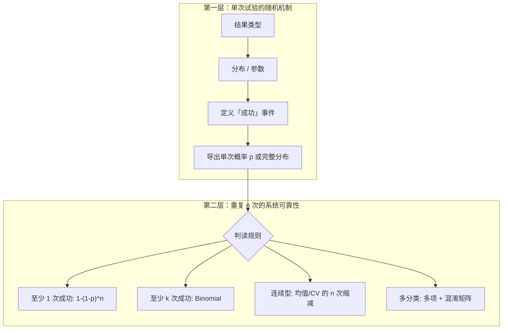

# 医学检验项目类型与 LOD 重复实验：深层框架

> 接续 `LOD_detection_probability.md`：当检测项目从「单一阴阳性」扩展到连续变量、计数、多分类时，**是否都要纳入？当前模型是否支持？如何更深一步思考？**

---

## 1. 结论先行

| 问题 | 回答 |
|------|------|
| 是否都应考虑？ | **应按项目类型区分**，不能用一个 \(p=0.9\) 套所有检验 |
| 当前模型支持什么？ | **直接支持**二分类定性 LOD 的「至少 1 次阳性」；**不直接支持**连续/多分类的完整判读 |
| 如何统一思考？ | **两层结构**：① 单次试验的随机模型 → 导出 \(p\) 或更一般分布；② 重复 \(n\) 次后的系统可靠性（二项 / 多项扩展） |

代码对应关系：

- 二分类 + 可视化：`lod_detection_analysis.py`
- 四类项目扩展模型：`lod_test_type_models.py`

---

## 2. 为什么「一种公式」不够？

医学检验的结果形态不同，**「检出」「成功」「可靠」** 的含义也不同：

```
                    ┌─────────────────────────────────────┐
                    │         医学检验结果形态             │
                    └─────────────────────────────────────┘
                                      │
        ┌─────────────┬───────────────┼───────────────┬─────────────┐
        ▼             ▼               ▼               ▼             ▼
   二分类阴阳性   连续变量定量    计数型(血细胞)    多分类(血型)   半定量/序数
   阳性/阴性      mg/L, IU/mL     cells/μL         A/B/O/AB      1+ 2+ 3+
```

当前核心公式 \(P = 1-(1-p)^n\) 隐含假设：

1. 每次试验只有 **成功 / 失败** 两种结局；
2. 各次 **独立**、**同分布**（同一 \(p\)）；
3. 「成功」= **检出 / 阳性**（或你已明确定义的事件）。

许多项目 **满足不了其中某条**，或「成功」不是简单阳性，需要换模型或先换算成 \(p\)。

---

## 3. 四类项目的深层机制

### 3.1 二分类阴阳性（当前模型：✅ 直接适用）

**典型项目**：病原体核酸/抗原、药物筛查、部分免疫定性。

- **单次模型**：\(Y \in \{\text{阴}, \text{阳}\}\)，\(P(\text{阳}) = p\)
- **LOD 语境**：在特定浓度 \(c\) 下，\(p(c)\) 往往用 logistic 描述（EP17）：

\[
p(c) = \frac{1}{1 + e^{-slope \cdot (c - c_{50})}}
\]

其中 \(c_{50}\) 为 50% 检出概率浓度。

- **重复实验**：\(P(\text{至少 1 次阳}) = 1-(1-p)^n\)；监管常用 **\(k/n\)**：\(P(X \ge k) = \sum_{i=k}^{n} \binom{n}{i} p^i(1-p)^{n-i}\)

**这是现有代码的精确适用域。**

---

### 3.2 连续变量定量（当前模型：⚠️ 需先导出 \(p\)）

**典型项目**：生化（肝功、血糖）、免疫定量（肿瘤标志物）、激素。

结果 \(Y\) 是 **连续随机变量**，通常 **不是**「先做伯努利再重复」，而是：

| 层次 | 问题 | 常用模型 |
|------|------|----------|
| 空白 / 低浓度 | 能否与空白区分？ | \(Y \sim N(\mu, \sigma^2)\)，LoB = \(\mu_0 + k\sigma_0\) |
| 检测下限 LoD | 低浓度检出概率 50% 的浓度 | 将 \(Y > \text{cutoff}\) 视为「检出」，得 \(p = P(Y>\text{cutoff})\) |
| 定量下限 LoQ | 不仅检出，还要能 **准确定量** | CV% = \(100\sigma/\mu < \) 目标（如 20%） |

**与二分类的衔接**：

若判读规则是「测量值 > cutoff 即为阳性」，则单次

\[
p = P(Y > \text{cutoff}) = 1 - \Phi\left(\frac{\text{cutoff} - \mu}{\sigma}\right)
\]

**之后** 仍可套用 \(1-(1-p)^n\) 讨论「\(n\) 次重复至少 1 次超过 cutoff」。

但若关心的是 **估计均值、CV、置信区间**，则应使用 **正态重复抽样**：

\[
\bar{Y} \sim N\left(\mu, \frac{\sigma^2}{n}\right)
\]

这是 **精度提升** 问题，与「至少检出一次」是 **不同维度** 的可靠性。

> **深层要点**：连续变量项目往往同时要回答「能不能检出」（定性）和「能不能准确定量」（定量）—— LoD 与 LoQ 两条线。

---

### 3.3 计数型：血细胞等（当前模型：⚠️ Poisson 层 + 可选二项层）

**典型项目**：白细胞、血小板、尿沉渣计数。

低浓度时 **计数 \(X \sim \text{Poisson}(\lambda)\)**（或带过度离散的 Poisson-gamma）：

\[
P(X = k) = \frac{\lambda^k e^{-\lambda}}{k!}
\]

「检出」常定义为 \(X > 0\) 或 \(X \ge\) 某病理阈值：

\[
p = P(X > 0) = 1 - e^{-\lambda}
\]

\(\lambda\) 很小时 \(p \approx \lambda\)；重复 \(n\) 个 **独立样本/视野** 时，仍可用 \(1-(1-p)^n\)。

\(\lambda\) 较大时（如 WBC 正常范围），问题通常 **不是 LOD**，而是 **计数精度**（CV、室间质评），用正态近似 \(X \approx N(\lambda, \lambda)\)。

> **深层要点**：同一「血细胞」在不同浓度区间 **换模型**—— 极低用 Poisson + 检出概率；正常范围用精度 / CV。

---

### 3.4 多分类：血型等（当前模型：⚠️ 须定义「成功」）

**典型项目**：ABO/Rh 血型、病原体分型、HLA。

单次结果是 **类别** \(C \in \{1,\ldots,K\}\)，用概率向量 \(\pi_1,\ldots,\pi_K\) 或混淆矩阵描述。

「成功」至少三种定义（**必须先选**）：

| 定义 | 含义 | 单次概率 |
|------|------|----------|
| 正确分类 | 判为真实血型 | \(p = \pi_{\text{true}}\) |
| 检出目标属性 | 如 Rh 阳性 | \(p = \sum_{k \in \text{目标类}} \pi_k\) |
| 非无效 | 非「未检出」 | \(p = 1 - \pi_{\text{null}}\) |

**重复 \(n\) 次独立试验、且关心「至少 1 次正确」** 时，仍可用 \(1-(1-p)^n\)，但 \(p\) 是 **正确率** 而非 **检出率**。

更完整的分析需要 **混淆矩阵 + 多项分布**：错分到哪一类、是否对称误判，**不能** 用一个笼统的 \(p=0.9\) 代表。

血型在常规浓度下 \(p_{\text{正确}}\) 往往 **极高（>0.99）**，重复实验要解决的常是 **罕见错分 / 弱凝集边界**，属于 **分类边界 + 质控** 问题，与病原体 LOD 的 **低 \(p\)** 逻辑不同。

---

## 4. 统一思维框架（推荐）

把任意项目拆成 **两层**：



**决策清单**（做 LOD / 重复实验设计前）：

1. **结果类型**：阴/阳、数值、计数、类别？
2. **监管/临床问的是什么**：检出？正确分类？定量 CV？
3. **单次模型**：Bernoulli、正态、Poisson、Logistic、Categorical？
4. **成功事件**：阳性、超 cutoff、正确类、CV<20%？
5. **独立性**：同一份血多次测 vs 独立取样？
6. **重复目的**：提高检出把握 vs 提高定量精度 vs 质控？

---

## 5. 当前代码支持矩阵

| 检验类型 | 单次模型 | 代码函数 | 重复层 |
|----------|----------|----------|--------|
| 二分类 | Bernoulli / Logistic | `prob_at_least_one`, `binary_single_prob_at_concentration` | ✅ |
| 二分类 k/n | Binomial | `prob_at_least_k` | ✅ |
| 连续定量 | Normal | `continuous_detection_prob`, `continuous_quantification_cv` | 导出 \(p\) 后 ✅ |
| 计数 | Poisson | `poisson_detection_prob` | 导出 \(p\) 后 ✅ |
| 多分类 | Categorical | `multiclass_success_prob` | 导出 \(p\) 后 ✅（简化） |

运行示例：

```bash
python lod_test_type_models.py
```

---

## 6. 同一 \(n=20\) 在不同项目下的含义（数值直觉）

以下均为 **独立重复、至少 1 次成功**（或等价事件）：

| 场景 | 单次 \(p\) | \(n=20\) 时把握 |
|------|-----------|----------------|
| 高把握定性 \(p=0.9\) | 0.9 | \(\approx 1\)（数学上极易） |
| LoD 附近 logistic \(c=c_{50}\) | 0.5 | \(1-0.5^{20} \approx 1\) |
| 连续：\(\mu=2,\sigma=1.5,cutoff=3\) | \(\approx 0.41\) | \(\approx 0.9997\) |
| Poisson \(\lambda=5\) | \(1-e^{-5}\approx 0.993\) | \(\approx 1\) |
| 血型正确率 98% | 0.98 | \(\approx 1\) |

可见：**\(n=20\) 不是普适常数**—— 在 \(p\) 已很高时几乎无增益；在 \(p\approx 0.1\)（真 LOD 低浓度）时，20 次才接近「约 88%」把握（\(1-0.9^{20}\)），仍可能不够 95%。

---

## 7. 尚未纳入、可继续扩展的方向

1. **半定量 / 序数**（凝集强度 1+～4+）：有序 logistic、阈值模型  
2. **异方差与 LoQ**：\(\sigma(c)\) 随浓度变化  
3. **非独立重复**：同管血、同批试剂 → 有效 \(n\) 折减  
4. **贝叶斯**：用先验更新「真实阳性」后验，而非固定 \(p\)  
5. **多变量质控**：Westgard 规则、偏倚 + 随机误差联合  
6. **完整 EP17 / CLSI**：Probit、非参数、单侧置信限  

---

## 8. 小结

- **都要考虑吗？** 若目标是「医学检验 LOD 与重复实验的通用方法论」，**必须按项目类型分层**；若只验证某一试剂在 LoD 浓度的 **阴阳性**，现有二分类模型足够。  
- **当前模型支持吗？** **核心层**（\(1-(1-p)^n\)）只覆盖 **二分类检出**；连续、计数、多分类需 **先建模单次结果 → 得到 \(p\)**，再接入同一重复层；定量 CV、混淆矩阵等 **需额外模块**。  
- **更深思考**：把问题拆成 **「单次随机机制」+「重复判读规则」+「临床/监管问的是什么」** 三维，避免用一个 \(p=0.9\) 或固定 20 次解释所有检验。

---

*参见：`lod_detection_analysis.py`、`lod_test_type_models.py`、`figures/fig6_required_n_by_p.png`*
